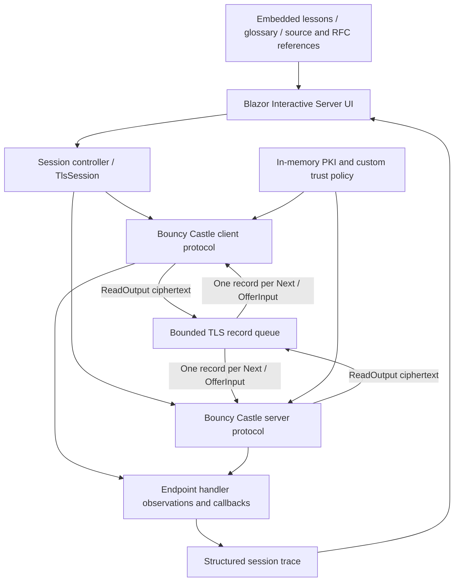

# Architecture

## Project boundaries

| Project | Responsibility |
| --- | --- |
| `MtlsLab.Core` | Scenario and trace models, record framing, handshake framing and public field decoding |
| `MtlsLab.Certificates` | Ephemeral demonstration PKI, X509Chain policy and public certificate views |
| `MtlsLab.Tls` | Genuine Bouncy Castle peers, instrumentation, record queue and serialised session execution |
| `MtlsLab.Education` | Immutable structured offline resources and learning-progress model |
| `MtlsLab.Web` | Interactive controls, sequence, inspectors, teaching panel and browser-session progress |
| `MtlsLab.Tests` | xUnit unit/integration tests using the actual cryptographic implementations |

## Protocol execution

The parameterless `TlsClientProtocol` and `TlsServerProtocol` constructors select non-blocking mode. `Accept` prepares the server. `Connect` starts the client and emits ClientHello bytes. `GetAvailableOutputBytes` and `ReadOutput` drain the engines without delivering anything.

`RecordFramer` buffers incomplete headers/payloads and emits complete records, preserving exact bytes and order. It accepts multiple records per input and enforces the TLS 1.3 ciphertext envelope limit of 16,640 payload bytes, plus a one-MiB transient buffer cap. A session retains at most 512 records and 4,096 trace events. Each peer caps handshake messages at 65,536 bytes. Application submissions are capped at 4,096 UTF-8 bytes.

`Next` dequeues one record and calls the other protocol's `OfferInput` once. That synchronous call can process several handshake messages, validate a certificate, advance internal states and create a response flight. Generated records are drained into the queue and wait for another action. The queue is globally ordered by generation; each direction's byte order is preserved.

`RunAsync` repeats deliveries with a cancellable delay. Pause cancels subsequent deliveries; it cannot interrupt an indivisible Bouncy Castle operation. A zero-delay programmatic run still yields for cancellation. `Reset` awaits the run's cancellation, disposes the old session and creates new peers and certificates.

Bouncy Castle owns handshake reassembly, protocol checks, ephemeral agreement, HKDF, signature verification, Finished verification and record AEAD. The laboratory's separate `HandshakeFramer` is used only to inspect visible outbound plaintext handshake bytes. It never decrypts anything.

## Observation provenance

| Provenance | Meaning |
| --- | --- |
| `RecordBytes` | Exact bytes or reassembled plaintext observable in the transport |
| `TlsImplementation` | An actual endpoint handler, processing outcome or decrypted application read |
| `Callback` | A real TLS peer callback or an explicitly executed certificate-policy decision |
| `LocalState` | Session configuration, submitted plaintext or other local application state |
| `Explanation` | Reserved for specification-based explanations; lessons are separate resources, not invented trace events |

Each event carries a session ID, monotonic sequence, UTC timestamp, peer, type, topic, result, source member and available record/message association. Endpoint handler events capture complete handshake encodings using `HandshakeMessageInput.ToArray()` without moving its cursor, then invoke the unmodified base method. `Processed` is recorded only after the handler succeeds; `Rejected` records an exception. The numeric BC connection state is exposed as such, rather than given an invented semantic name.

An endpoint event's record ID is the delivery that **completes or triggers** that observation. If a handshake message spans multiple records, the trace does not claim that its bytes all came from that last record. Outgoing encrypted messages are not assigned guessed plaintext labels; they become inspectable when the receiving handler actually sees them.

TLS 1.3 outer type 23 can carry an encrypted handshake, alert or application payload. Its wire inspector remains opaque. Compatibility ChangeCipherSpec records are displayed as actual records, excluded from handshake-message history.

## Certificates and trust

Each session generates two roots and the teaching leaves using .NET `CertificateRequest`, ECDSA P-256 and SHA-256. Server SAN is `localhost`; client leaves carry clientAuth. The independent root and deliberately invalid leaves isolate particular failures. All certificates and keys remain in process memory. No operating-system trust store is changed.

The TLS credentials use `BcDefaultTlsCredentialedSigner` and in-memory conversion of the generated ECDSA key. The chain is encoded with TLS 1.3 `CertificateEntry` objects. The issuing root is sent for teaching clarity, but trust is exclusively receiver policy.

The client callback validates the received server chain, serverAuth purpose and the configured reference DNS name. The server callback validates clientAuth and rejects an empty chain when authentication is required. `X509ChainTrustMode.CustomRootTrust` prevents accidental reliance on OS public roots. Explicit leaf checks cover validity, non-CA constraints, DigitalSignature KU and the required EKU. `X509Chain.Build` supplies real aggregate path/signature/constraint diagnostics; exact root DER matching confirms the selected anchor. DNS matching uses SAN only, with CN fallback and wildcards disabled for this fixed-host lab.

Revocation is explicitly `NoCheck` and certificate downloads are disabled. No CRL/OCSP infrastructure is implied. A successful certificate callback is shown as “awaiting proof and Finished” until the real TLS completion callback.

## Session and UI ownership

A `Home` component owns exactly one `TlsSession`; it is not a singleton. The session gate serialises engine operations. The UI suppresses concurrent manual delivery while Run is active and cancels/awaits it before reset or component disposal. Independent browser circuits have distinct keys, queues and identity decisions.

ContentCatalogue is a singleton only because its resources are immutable teaching data. Lesson depth, pinning and history selection never call TLS operations. Progress and quiz answers use protected browser-tab session storage. The protection provider is ephemeral, so a server restart makes old progress unreadable and the UI starts fresh. Private TLS material never enters that storage.

Static framework assets are served using .NET 10's asset manifest and fingerprint-aware `Assets` references. The web listener defaults to loopback HTTP and a restrictive localhost host allowlist. The local control page is a different security boundary from the experimental channel.

## Explicit boundaries

The shipped experiments use one modern suite/group/signature combination and fresh full handshakes. They do not expose arbitrary destinations, live traffic-secret export, resumption, early data, a production authorisation system or internal cryptographic pausing. The visual key schedule is conceptual, not a live-key display. Reference RFC/source links need Internet access when opened; the teaching material does not.
